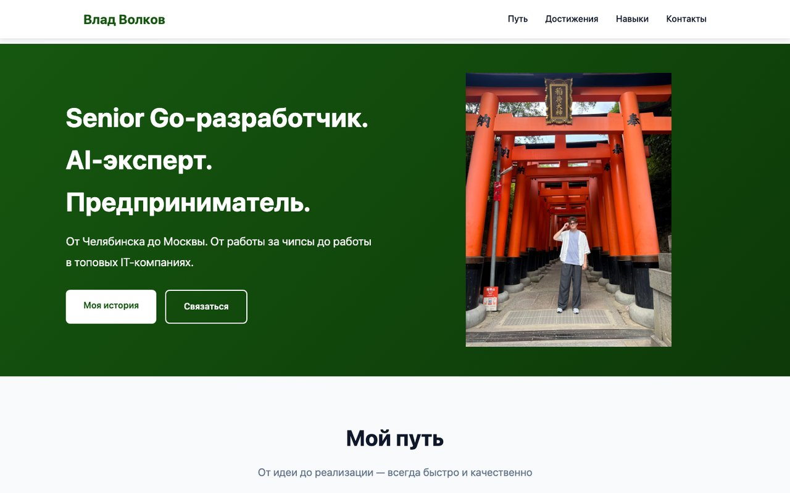
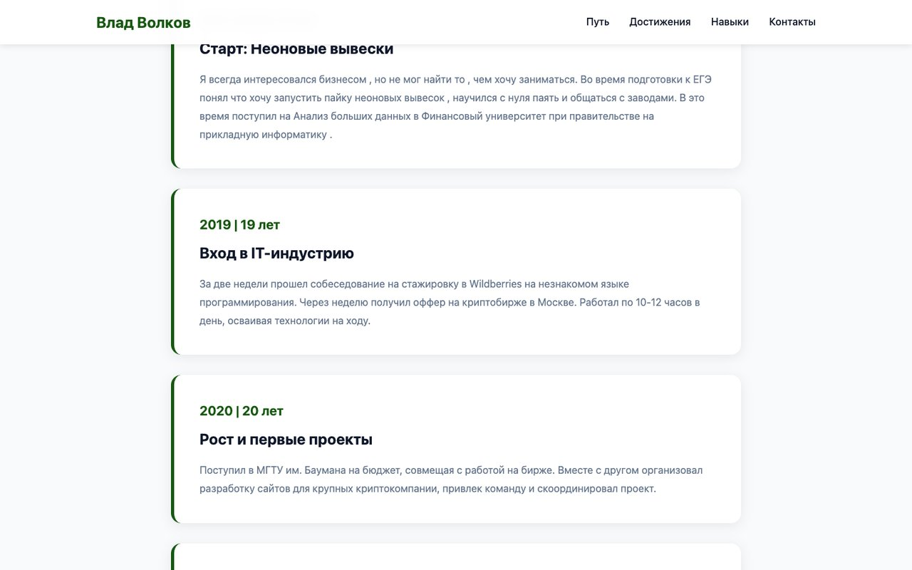
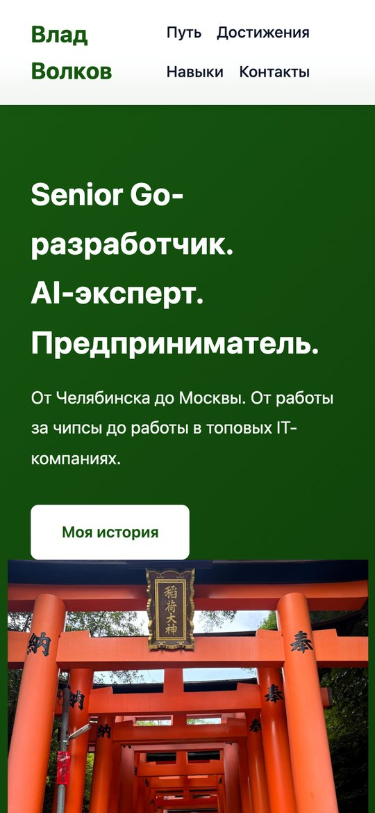
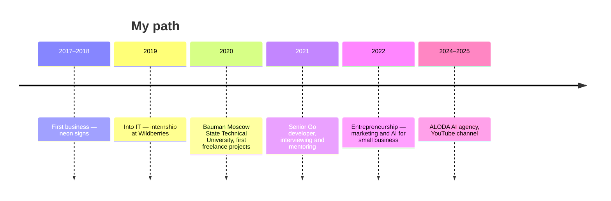

# Personal website — Vlad Volkov

A single-page personal website: **Senior Go developer, AI expert, entrepreneur.** It tells the story from a first business at 17 to working at top IT companies and founding an AI agency.



| Timeline | Mobile |
|:---:|:---:|
|  |  |

## Sections



- **Achievements** — self-education, fast learning, Senior at 21, mentoring 15+ people into IT, AI automation for business
- **Skills** — Go, Python, JavaScript, backend architecture, microservices; ChatGPT / Claude APIs, AI chatbots, workflow automation; integrations with YClients, amoCRM, Bitrix24, WhatsApp Business, Telegram bots
- **Philosophy** and **contacts**

## Stack

One self-contained HTML file (`personal_website.html`) with inline CSS and JavaScript — no dependencies and no build step. Responsive layout and scroll animations.

## Run locally

```bash
python3 -m http.server 8000
# open http://localhost:8000/personal_website.html
```
